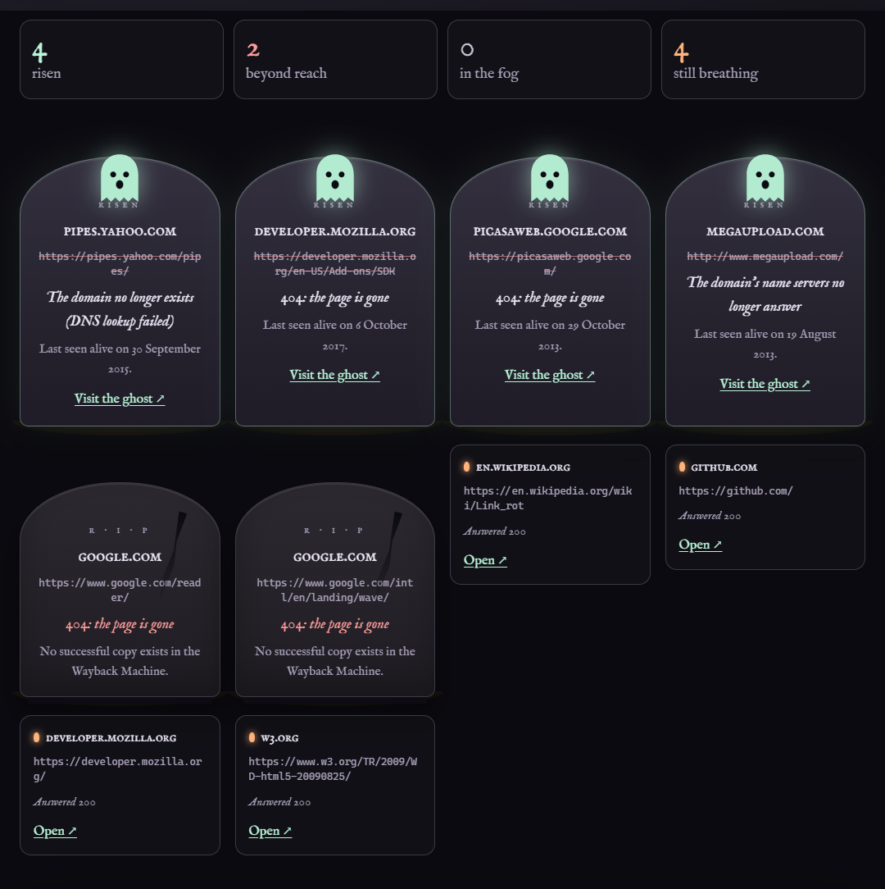

# 👻 Séance: talk to the dead web

**Séance finds the dead links in any document or web page and brings them back from the Internet Archive's Wayback Machine.**

Every README, blog post, bibliography and wiki you've ever written is slowly rotting.
Links die quietly: domains expire, companies shut down, sites get redesigned. Readers hit a 404
and the knowledge behind that link is gone. Séance holds a séance for every link in your text:

1. **Summon.** Extracts every `http(s)` link: Markdown, HTML, autolinks, bare URLs.
2. **Check the pulse.** Knocks politely (HEAD, then GET), with at most 8 requests at once and 2 per site.
3. **Bury the dead.** 404, 410, vanished domains, broken DNS, timeouts and 5xx go in the ground.
   403 and 429 stay *in the fog*: Séance never calls a link dead without proof.
4. **Resurrect.** Asks the Wayback Machine for the link's last *healthy* snapshot, never an archived copy of its 404 page.
5. **Exorcise.** Gives you the document back with every resurrected link rewritten, and nothing else changed.

> Live demo: _add the deployed URL here_ · Demo video: _add the YouTube link here_

[](https://render.com/deploy?repo=https://github.com/Chetansahney/seance)



## Run it

Requires Node.js 20 or newer. No runtime dependencies.

```bash
npm install        # dev dependency only (fast-check, for property tests)
npm start          # http://localhost:3666
```

Click **Try a haunted README** to scan a sample with real dead links.

### Deploy

- **Render (free):** click the *Deploy to Render* button above. It reads [`render.yaml`](render.yaml); no settings are needed.
- **Anywhere with Docker:** `docker build -t seance . && docker run -p 3666:3666 seance`
- **Any Node host:** `npm ci --omit=dev && node src/server.js` (it listens on `$PORT`).

### Command line and CI

```bash
node bin/seance.js README.md          # report; exits 1 if any link is dead
node bin/seance.js README.md --fix    # rewrite dead links to their archived copies
node bin/seance.js README.md --json   # machine-readable report
node bin/seance.js README.md --quiet  # only show dead links
```

### GitHub Action

Fail a pull request when a link dies:

```yaml
- uses: actions/checkout@v4
- uses: Chetansahney/seance@main
  with:
    files: README.md docs/guide.md   # space-separated (default: README.md)
    fix: false                       # true rewrites dead links instead of failing
```

### Accessibility audit

`npm run test:a11y` runs axe against the home page and a finished scan in Microsoft Edge (dev dependencies only).

### API

`POST /api/scan` with `{ "text": "..." }` or `{ "url": "https://..." }` returns a
Server-Sent Events stream: `found`, then one `result` per link, then `done` with the summary and the fixed document.

## How it is built

```
src/core/    pure, property-tested logic (extract, classify, snapshot, rewrite)
src/net/     probing, SSRF guard, Wayback CDX client, concurrency pool
src/scan.js  orchestration and event stream
src/server.js  zero-dependency HTTP server with SSE
public/      the haunted UI (no framework, no build step)
bin/         CLI
.kiro/       spec, steering docs and hooks used to build it with Kiro
```

- **Correct by construction.** The rewrite only replaces whole extracted links, so `https://a.com/x` never corrupts `https://a.com/xyz`,
  and an archived link is never re-archived (the rewrite is idempotent). Seven correctness properties from the design are checked with
  [fast-check](https://github.com/dubzzz/fast-check): `npm test`.
- **Safe to host.** Requests to private, loopback and link-local addresses are refused, so a deployed Séance cannot be used to probe its own network.
- **Accessible horror.** Every animation is turned off under `prefers-reduced-motion`, all colors meet WCAG AA, and everything works with a keyboard.

## Built with Kiro

See [docs/KIRO_USAGE.md](docs/KIRO_USAGE.md) and the [`.kiro`](.kiro) folder: the spec
(requirements in EARS form, design with correctness properties, task list), steering docs and agent hooks.

## Credits

Archived copies come from the [Internet Archive](https://archive.org/), a non-profit that deserves your
[support](https://archive.org/donate). Fonts: IM Fell, by Igino Marini (SIL Open Font License).

## License

[MIT](LICENSE)
