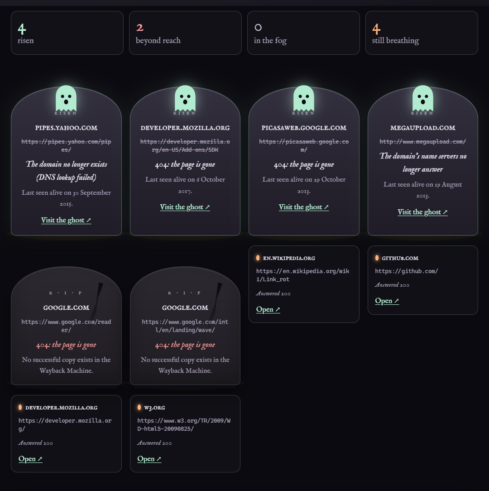

# Blog post (draft)

Rules: publish on a public third-party platform (dev.to, Medium, Hashnode…) during the submission period,
about Kiro **and** your project, and say it was written for the Kiroween 2026 hackathon. Add the URL to your submission.
Sections marked ✍️ must come from your own Kiro sessions.

---

# Holding a séance for the dead web: how I built a link-rot fixer with Kiro

*This post was written as part of the Kiroween 2026 hackathon.*

## Six of my ten links were dead

I took an old README, a reading list about the early social web, and checked its links. Six of ten were dead.
Yahoo! Pipes, Picasa Web Albums, Google Reader, Megaupload, an old Firefox SDK page, a Google Wave landing page.
Nobody had noticed, because links don't fail loudly. They just stop.

This is link rot, and it's everywhere: documentation, academic citations, court opinions, Wikipedia references.
The good news is that most dead pages aren't really gone. The Internet Archive's Wayback Machine has been
saving copies for nearly 30 years. What's missing is a tool that goes and gets them.

## Séance

[Séance](https://github.com/Chetansahney/seance) holds a séance for every link in a document:

1. **Summon:** find every link (Markdown, HTML, bare URLs).
2. **Check the pulse:** knock politely (HEAD, then GET, at most two requests per site at a time).
3. **Bury the dead:** 404, 410, vanished domains, broken DNS, timeouts, 5xx.
4. **Resurrect:** fetch the link's last *healthy* snapshot from the Wayback Machine.
5. **Exorcise:** hand back the document with dead links rewritten, and nothing else touched.

## Three things that were harder than they looked

**"Dead" is a strong word.** Many sites return 403 to anything that looks like a bot, and 429 when busy.
Calling those dead would make Séance rewrite working links, which is worse than doing nothing.
So Séance has a third state, *in the fog*, and only buries a link with real evidence.
Seized domains were a surprise: megaupload.com doesn't return "not found" from DNS, it returns SERVFAIL forever.

**The newest snapshot is usually the wrong one.** When a page dies, the Wayback Machine keeps crawling it,
so the most recent capture is often the 404 page itself. Séance asks only for captures that returned a 2xx status
and picks the newest of those: the last time the page was alive.

**Rewriting text is easy to get subtly wrong.** A naive find-and-replace for `https://a.com/x` corrupts
`https://a.com/xyz`, and running the fix twice can archive an archive link. Séance only replaces whole extracted links,
and an archived link is extracted as a single link, so the fix is idempotent.

## How Kiro shaped the build ✍️

**Spec first.** ✍️ [How you used the requirements → design → tasks flow. Quote one EARS criterion that changed the code,
for example Requirement 3.2, "never resurrect a link as its own archived 404 page".]

**Correctness properties and property-based tests.** The design lists seven properties (extraction soundness,
rewrite idempotence, snapshot validity…) and each one is a fast-check test. ✍️ [Did PBT catch anything? Paste the counterexample.]

**Steering.** ✍️ [Which steering doc made the biggest difference, with an example of a response that changed.]

**Hooks.** ✍️ [Which hooks fired, and a concrete thing one caught: a failing test, a missing reduced-motion rule…]

**MCP.** ✍️ [Which server you added and what it let Kiro do.]

## Try it

- Live: [URL]
- Code (MIT): https://github.com/Chetansahney/seance
- In CI: `node bin/seance.js README.md` exits with code 1 when a link dies; `--fix` rewrites it.

And if Séance saves one of your links, consider [donating to the Internet Archive](https://archive.org/donate). They did the hard part.
